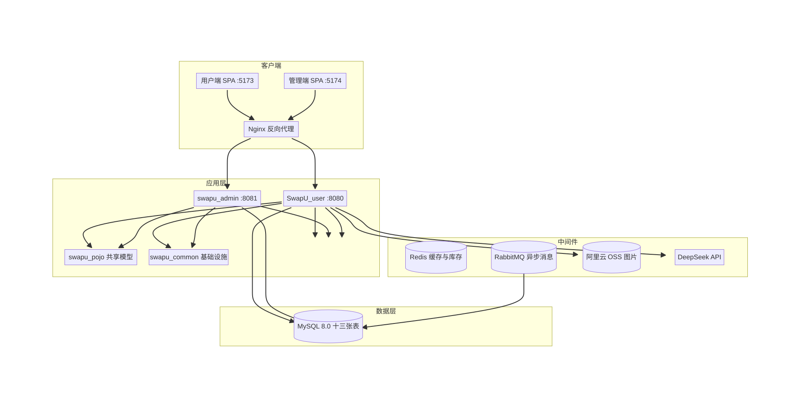
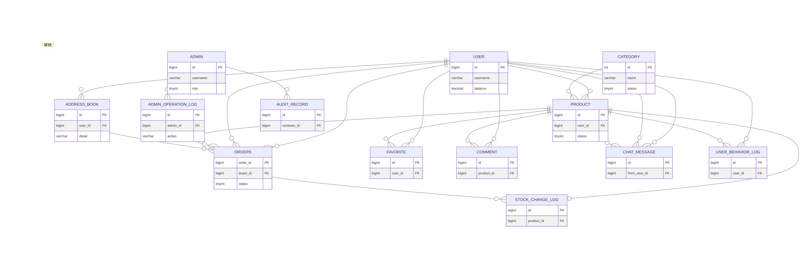
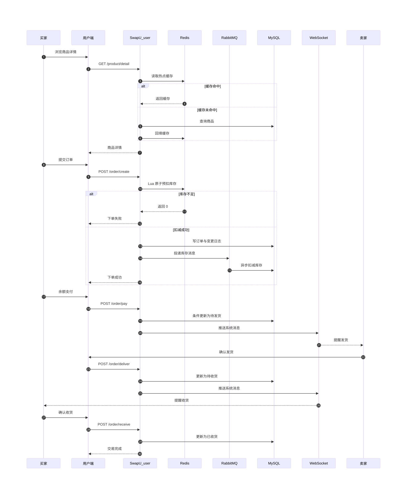

<div align="center">

  
  
  <h1>SwapU 云市集</h1>
  <p><b>面向校园场景的 C2C 二手交易平台 · 前后端分离 + 双端（用户端 / 管理端）</b></p>

  
  
  
  
  
  
  
  
  <div style="margin-top: 10px;">
    
    
    
    
    
  </div>
</div>

## 项目简介

SwapU 是一个面向校园场景的 C2C 二手交易平台，采用**前后端分离 + 双端应用**架构：用户端负责商品浏览、交易与沟通，管理端负责内容审核、运营与平台治理。

项目以「工程化」而非「功能堆砌」为目标，围绕四条技术主线展开：

| 主线 | 解决的问题 | 关键实现 |
| :--- | :--- | :--- |
| **交易一致性** | 高并发下单场景下的超卖与订单状态错乱 | Redis + Lua 原子预扣库存、RabbitMQ 异步落库、DB 条件更新保证状态流转幂等、定时对账兜底 |
| **热点读性能** | 商品详情与热门列表的重复查询压力 | 热点商品缓存 + 详情缓存 + 浏览量异步批量回写，缓存失效后回源数据库 |
| **异步与削峰** | 行为埋点、库存变更等非主链路写操作拖慢响应 | Redis 缓冲 + 定时批量落库 + 消息队列消费 |
| **智能化能力** | 商品与用户兴趣的匹配效率 | 用户行为画像（时间衰减加权）、多路召回 + 固定权重融合、LLM 语义重排序与 AI 客服（失败自动降级） |

**工程规模（截至当前版本）**

| 指标 | 数值 |
| :--- | :--- |
| 后端模块 | 2 个可执行应用（用户端 / 管理端）+ 2 个公共模块 |
| REST 接口 | **87 个**（用户端 57 / 管理端 30） |
| Java 代码 | **247 个类 / 约 1.43 万行** |
| 数据库表 | **13 张** |
| 前端工程 | 2 个独立 Vue 3 项目，共 32 个页面 |
| 单元测试 | **74 个**（用户端 24 / 管理端 50），覆盖权限、订单越权、支付、统计等领域 |

设计上强调**边界与可维护性**：严格 `Controller → Service → Mapper` 分层、统一响应体 `Result{code,msg,data}`、全局异常收敛、常量三件套（文案 / 数值 / 字符串）、敏感配置外置（`application.yml` 不入库，仅提交 `.example` 模板）。

## 功能特性

**用户端**

- 📱 **账号体系**：注册、登录（JWT）、修改资料、修改密码、独立支付密码（BCrypt，与登录密码解耦）
- 🛒 **商品交易**：发布、编辑、上下架、删除、分类筛选、多维排序、分页、商品详情、浏览足迹
- 📋 **订单流转**：下单、余额支付、卖家接单、发货、确认收货、取消（含卖家审核）、退货退款（含卖家审核）、超时自动取消、订单统计
- 💬 **即时沟通**：WebSocket 实时消息、会话列表、历史消息、已读同步、系统小助手（订单状态自动提醒）
- 🎯 **推荐与智能**：行为埋点 → 用户画像 → 多路召回 → LLM 语义重排；AI 客服悬浮窗
- ⭐ **社区能力**：收藏、评论（审核后可见）、他人主页

**管理端**

- 🛡️ **RBAC 权限体系**：超级管理员 / 运营管理员 / 普通管理员三种角色，四个权限点（审核 / 分类 / 用户 / 管理员），接口级拦截 + 越权 403
- ✅ **内容审核**：商品审核、评论审核、审核流水追溯
- 🗂️ **运营管理**：分类 CRUD 与启停、用户查询 / 启停 / 信用分调整 / 交易统计
- 👥 **账号治理**：管理员增删改启停、逻辑删除、禁止自我提权、至少保留一名启用超管、操作日志审计
- 📊 **数据看板**：核心指标总览、流量趋势折线、商品状态分布、分类成交额 Top N（ECharts 按需引入）

**平台能力**

- 库存预扣减 + 异步落库 + 对账补偿，热点商品缓存，浏览量批量同步
- 统一鉴权（双端独立密钥）、统一异常与参数校验、操作日志与行为日志
- 一套代码支撑两个独立前端与两个后端进程，公共模型与基础设施复用

## 项目结构

| 模块 | 类型 | 说明 |
| :--- | :--- | :--- |
| `SwapU_user` | Spring Boot 应用（:8080） | 用户端服务：账号、商品、订单、聊天、推荐、AI 客服 |
| `swapu_admin` | Spring Boot 应用（:8081） | 管理端服务：管理员与 RBAC、审核、分类、用户管理、操作日志、平台统计 |
| `swapu_pojo` | 依赖库 | 共享模型：`entity` / `dto` / `vo` / 统一分页结果 |
| `swapu_common` | 依赖库 | 共享基础设施：常量三件套、异常基类、JWT / OSS 工具、上下文、配置属性 |
| `swapu_front` | Vue 3 SPA（:5173） | 用户端前端，22 个页面 |
| `swapu_admin_front` | Vue 3 SPA（:5174） | 管理端前端，10 个页面，含 ECharts 图表 |
| `docs` | 文档 | 接口文档、数据库设计、编码规范、优化说明、TODO、RBAC 方案、微服务方案 |
| `screenshot` | 资源 | 页面截图 |

工程约定：

- 后端严格分层，`controller` 不写业务、`service` 不碰 Servlet API、`entity` 不直接对外暴露；
- 请求 / 响应 / 持久化三件套分离（DTO / VO / Entity），跨层转换统一 `BeanUtils.copyProperties`；
- 数据库敏感配置通过 `.example` 模板提供，真实 `application.yml` 已被 `.gitignore` 排除；
- 每个功能变更配套单元测试，管理端权限与订单安全相关逻辑全部有回归用例。

## 项目文档

| 文档 | 内容 |
| :--- | :--- |
| [用户端接口文档](docs/swapu_interface_doc.md) | 用户端 57 个接口的请求/响应与错误码 |
| [管理端接口清单](docs/swapu_admin_api_inventory.md) | 管理端 30 个接口（源码核对版，含鉴权与权限点） |
| [管理端接口设计稿](docs/swapu_admin_interface_doc.md) | 早期设计稿，与清单冲突时以清单为准 |
| [数据库设计](docs/swapu_database.md) | 13 张表的字段、索引、ER 关系与建表 SQL |
| [编码规范](docs/swapu_coding_conventions.md) | 分层、命名、注解、异常、常量、日志等约定 |
| [性能优化说明](docs/swapu_optimization.md) | 缓存策略、库存预扣减、推荐链路的设计取舍 |
| [RBAC 方案与实施记录](docs/swapu_admin_rbac.md) | 角色权限模型、鉴权链路、逻辑删除、操作日志、分阶段实施 |
| [微服务改造方案](docs/swapu-microservices-plan.md) | 服务划分、鉴权载体、一致性与分阶段路线（规划） |

## 项目地址

本项目的所有代码已经托管到 GitHub 和 Gitee 上，欢迎 Star 和 Fork 支持~

- GitHub：https://github.com/windyfreez/SwapU
- Gitee：https://gitee.com/OriginalPlayer/SwapU

## 技术选型

### 后端技术

| 技术 | 版本 | 实现功能 |
| :--- | :--- | :--- |
| Spring Boot | 2.7.15 | 应用基础框架、自动配置、RESTful API |
| MyBatis | 2.3.2 (starter) | 持久层，注解 + XML 动态 SQL |
| PageHelper | 1.4.7 | 物理分页 |
| MySQL | 8.0 | 业务数据持久化（13 张表） |
| Redis | 6.x | 热点商品缓存、库存预扣减（Lua）、行为缓冲、AI 调用限流 |
| RabbitMQ | 3.9+ | 库存变更异步落库、削峰填谷 |
| WebSocket | Spring WebSocket | 买卖双方全双工实时通信 |
| JWT (jjwt) | 0.9.1 | 双端身份认证，用户端与管理端独立密钥 |
| Hutool | 5.7.17 | BCrypt 摘要、HTTP 客户端（DeepSeek）、集合工具 |
| 阿里云 OSS | 3.17.4 | 商品图片对象存储 |
| Spring Schedule | 内置 | 热门商品刷新、浏览量同步、订单超时关闭、库存对账 |
| knife4j / springfox | 3.0.2 | 在线接口文档（`/doc.html`） |
| Lombok | 内置 | 简化样板代码 |
| Bean Validation | 内置 | 请求参数校验（`@Valid` + 约束注解） |

### 前端技术

| 技术 | 版本 | 实现功能 |
| :--- | :--- | :--- |
| Vue 3 | 3.2 | 组合式 API（`<script setup>`）构建响应式界面 |
| Vue Router | 4.x | 集中式路由与权限守卫 |
| Vite | 3.x | 开发服务器、HMR、生产构建、接口代理 |
| ECharts | 6.1（仅管理端） | 折线图 / 饼图 / 条形图，按需引入 + 路由级懒加载 |
| 原生 CSS | — | 手写设计系统（CSS 变量 + 组件化样式），未引入 UI 组件库 |
| Nginx | 1.22 | 静态资源托管与反向代理 |

### 系统架构图



| 层次 | 组件 | 职责 |
| :--- | :--- | :--- |
| 客户端 | 用户端 SPA（:5173） | 商品浏览、下单支付、聊天、个人中心 |
| 客户端 | 管理端 SPA（:5174） | 审核、分类、用户、管理员、操作日志、数据看板 |
| 接入 | Nginx | 静态资源托管、反向代理、WebSocket 透传 |
| 应用 | SwapU_user（:8080） | 账号、商品、订单、聊天、推荐、AI 客服 |
| 应用 | swapu_admin（:8081） | RBAC、审核、分类、用户管理、操作日志、平台统计 |
| 公共 | swapu_pojo / swapu_common | 共享模型与基础设施（常量、异常、JWT、OSS、上下文） |
| 中间件 | Redis / RabbitMQ / OSS / DeepSeek | 缓存与库存预扣、异步削峰、图片存储、智能能力 |
| 数据 | MySQL 8.0（13 张表） | 业务数据持久化 |

> 图源：[docs/diagrams/architecture.mmd](docs/diagrams/architecture.mmd)，可在 [mermaid.live](https://mermaid.live) 打开编辑后重新导出。

### 数据库ER图：



> 完整字段、索引与建表 SQL 见 [数据库设计](docs/swapu_database.md)；图源：[docs/diagrams/er-model.mmd](docs/diagrams/er-model.mmd)。

## 业务架构

系统按业务边界拆分为五个协作模块，模块之间通过 Service 接口与共享模型交互，共同支撑"发布 → 审核 → 交易 → 沟通 → 结算"的完整闭环。

### 用户管理模块

用户管理模块承担身份认证与基础资料维护，是平台运行的前提。系统基于 JWT 实现无状态鉴权，用户端与管理端使用独立密钥与独立拦截器，互不越界；密码与支付密码分离存储，支付密码采用 BCrypt 加盐摘要，并支持历史账号的惰性升级。模块同时提供收藏管理、足迹查询与公开主页，为商品浏览与交易行为提供身份与偏好基础。


### 商品管理模块

商品管理模块覆盖商品全生命周期：发布后进入待审核队列，审核通过后上架销售；支持分类筛选、价格区间、成色与多字段排序，列表仅返回封面图、详情才返回完整图集以控制传输体积。热门商品与详情走 Redis 缓存，浏览量在内存累加后由定时任务批量回写，避免高频写放大。管理端在此基础上提供审核、分类维护与状态治理能力。


### 订单管理模块

订单模块以状态机驱动交易流转：`待确认 → 待支付 → 待发货 → 待收货 → 已收货`，并支持取消申请、退货退款两条逆向流程。核心设计有三点：**条件更新代替"先查后改"**，通过 `where status = ?` 保证并发下状态只流转一次；**下单即锁定库存**，Redis 预扣减挡住超卖请求，DB 侧仍有 `quantity >= ?` 兜底；**超时自动关单**由定时任务扫描并回补库存，已支付订单同步退款。


### 即时通讯模块

即时通讯模块基于 WebSocket 实现买卖双方全双工通信，采用"发送走 HTTP、接收走 WebSocket"的混合模式：发送方拿到同步响应，接收方由服务端主动推送，兼顾可靠性与实时性。会话按商品维度组织，消息持久化后支持历史回溯与已读同步；"系统小助手"作为平台侧虚拟会话，在订单每个节点自动向对应角色推送下一步提示。


### 辅助服务模块

辅助服务模块为业务模块提供横切支撑：对象存储承载图片、Redis 承载热点缓存与库存计数、消息队列承载异步写、定时任务承载对账与补偿。此外，模块封装了统一响应体、全局异常处理、参数校验、操作日志与行为埋点等基础设施，使业务代码只关注领域逻辑。

### 商品交易流程图



> 图源：[docs/diagrams/trade-flow.mmd](docs/diagrams/trade-flow.mmd)。

## 环境搭建

### 开发工具

| 工具 | 说明 | 官网 |
| :---: | :---: | :--- |
| IDEA | Java 开发 IDE | https://www.jetbrains.com/idea/download |
| WebStorm | 前端开发 IDE | https://www.jetbrains.com/webstorm/ |
| RedisInsight | Redis 可视化工具 | https://redis.com/redis-enterprise/redis-insight/ |
| DataGrip | 数据库开发工具 | https://www.jetbrains.com/datagrip/download |

### 开发环境

| 工具 | 版本号 | 下载地址 |
| :---: | :---: | :--- |
| JDK | 17 | https://www.oracle.com/java/technologies/javase/jdk17-archive-downloads.html |
| Maven | 3.8+ | https://maven.apache.org/download.cgi |
| MySQL | 8.0+ | https://www.mysql.com/downloads/ |
| Redis | 6.0+ | https://redis.io/download |
| RabbitMQ | 3.9+ | https://www.rabbitmq.com/download.html |
| Node.js | 18 LTS | https://nodejs.org/zh-cn/download |
| Nginx | 1.22+ | https://nginx.org/en/download.html |

## 快速开始

### 环境要求

- JDK 17+、Maven 3.8+
- MySQL 8.0+（需支持 `JSON` 类型）
- Redis 6.0+、RabbitMQ 3.9+
- Node.js 18 LTS+（两个前端均使用 Vite 3）
- 如需图片上传与 AI 能力，还需准备阿里云 OSS 与 DeepSeek API Key（可选，缺失时相关功能不可用）

### 后端启动

```bash
# 1. 克隆项目
git clone https://github.com/windyfreez/SwapU.git
cd SwapU

# 2. 创建数据库（注意库名为 campus）
mysql -u root -p -e "CREATE DATABASE campus CHARACTER SET utf8mb4 COLLATE utf8mb4_unicode_ci;"

# 3. 初始化表结构（按顺序执行，缺表/缺列会导致启动或登录失败）
mysql -u root -p campus < swapu_admin/src/main/resources/sql/admin.sql
mysql -u root -p campus < swapu_admin/src/main/resources/sql/admin_v2.sql
mysql -u root -p campus < swapu_admin/src/main/resources/sql/admin_operation_log.sql
mysql -u root -p campus < SwapU_user/src/main/resources/sql/user_pay_password.sql
mysql -u root -p campus < SwapU_user/src/main/resources/sql/stock_change_log.sql
# 其余业务表见 docs/swapu_database.md 的建表 SQL

# 4. 准备配置文件（仓库只提交模板，真实配置不入库）
cp SwapU_user/src/main/resources/application.yml.example   SwapU_user/src/main/resources/application.yml
cp swapu_admin/src/main/resources/application.yml.example  swapu_admin/src/main/resources/application.yml
# 按需填写：数据库账号密码、Redis、RabbitMQ、OSS（可用环境变量 ALIYUN_ACCESS_KEY_ID 注入）、DeepSeek API Key

# 5. 构建并启动（两个应用分别启动）
mvn -pl swapu_pojo,swapu_common -am install -DskipTests
mvn -pl SwapU_user  spring-boot:run     # 用户端 :8080
mvn -pl swapu_admin spring-boot:run     # 管理端 :8081
```

### 前端启动

```bash
# 用户端
cd swapu_front
npm install
npm run dev            # http://localhost:5173

# 管理端（新开一个终端）
cd swapu_admin_front
npm install
npm run dev            # http://localhost:5174
```

> 两个前端分别通过 Vite proxy 转发到 8080（用户端）与 8081（管理端），无需额外配置 CORS。

### 访问地址

| 服务 | 地址 | 说明 |
| :--- | :--- | :--- |
| 用户端前端 | http://localhost:5173 | Vue 3 SPA |
| 管理端前端 | http://localhost:5174 | Vue 3 SPA + ECharts |
| 用户端 API | http://localhost:8080 | REST + WebSocket |
| 管理端 API | http://localhost:8081 | REST |
| 用户端接口文档 | http://localhost:8080/doc.html | knife4j |
| 管理端接口文档 | http://localhost:8081/doc.html | knife4j |
| MySQL | localhost:3306/campus | 13 张业务表 |
| Redis | localhost:6379 | 缓存与库存 |

> 管理员账号由 `sql/admin.sql` 初始化。**首次登录后请立即修改密码**，并在生产环境替换 JWT 密钥与数据库凭据。

### 部署说明

```bash
# 1. 后端打包（两个可执行 jar）
mvn -pl SwapU_user  -am clean package -DskipTests
mvn -pl swapu_admin -am clean package -DskipTests
java -jar SwapU_user/target/*.jar      # :8080
java -jar swapu_admin/target/*.jar     # :8081

# 2. 前端打包
cd swapu_front        && npm ci && npm run build   # 产物 dist/
cd swapu_admin_front  && npm ci && npm run build   # 产物 dist/
```

Nginx 建议配置：静态资源分别托管两个 `dist`，`/api`、`/product`、`/order`、`/user`、`/ws` 反向代理到 8080，`/admin` 反向代理到 8081；WebSocket 需开启 `Upgrade` 头透传。

生产环境还需注意：

- 将 `application.yml` 中的数据库、Redis、JWT 密钥替换为环境变量注入；
- 关闭或限制 knife4j 文档（管理端已支持 `knife4j.production=true`）；
- 库存对账、订单超时关闭等定时任务是单机模型，多实例部署前需要引入分布式锁或改为消息驱动。

## 贡献指南

欢迎贡献代码！请遵循以下流程：

1. Fork 本仓库
2. 创建特性分支：`git checkout -b feature/AmazingFeature`
3. 提交更改：`git commit -m 'feat: add some feature'`（建议遵循 Conventional Commits）
4. 推送到分支：`git push origin feature/AmazingFeature`
5. 发起 Pull Request，并在描述中说明动机、方案与验证方式

提交前建议自检：

- `mvn -pl swapu_pojo,swapu_common,SwapU_user,swapu_admin -am clean test-compile` 能通过；
- 涉及管理端权限、订单状态的改动补充对应单元测试；
- 新增接口同步更新 `docs/` 下的接口清单。
